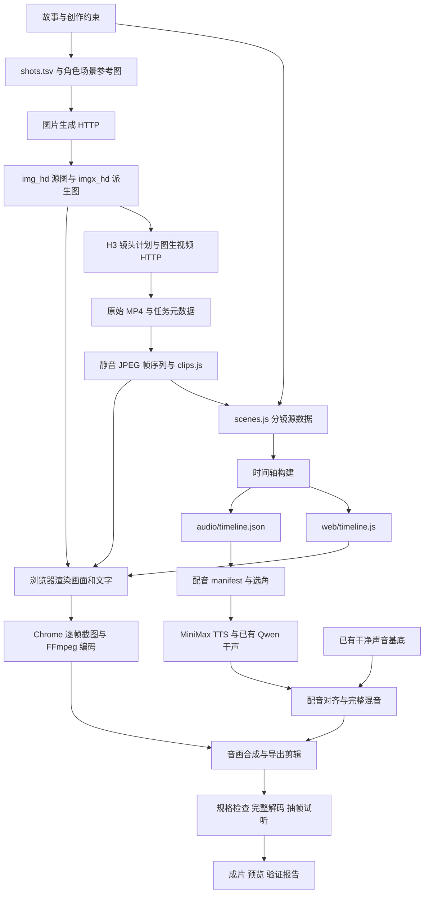
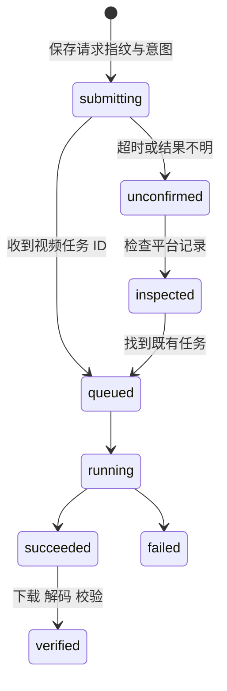

# 用 Agent 制作一部讲 Agent 的电影：可复用学习笔记

整理日期：2026-10-02。依据当前代码、素材清单、验证报告与本次制作反馈；交付基线为 v17。

## 1. 这次项目在探索什么

账号持续讨论的问题是：**AI-Agent 进入不同的行业、不同的世界，会碰撞出怎样的现实？**

《红色报错：救赎》把西部片的时代落幕、团队瓦解与传承，搬进程序员的办公室。老亚面对的不只是一个更快的工具，还有自己过去十五年的经验如何被重新定价。影片的制作过程也在发生同一件事：生成模型接手部分画面和声音的执行，创作者不断决定什么值得保留、什么需要修改。

因此，制作过程可以成为账号主题的第二层表达：在讲述 Agent 如何改变一个世界时，我们自己的创作流程也被 Agent 改变。可展示的内容是实际选择、失败与修订，以及这些变化给工作带来的影响。

当前项目适合学习的是一套小规模、可检查的制作流程。它仍有大量针对这部片的脚本与约定，尚不是通用视频制作平台。

## 2. 最重要的架构选择

**生成模型负责产出候选素材，代码负责把素材组织成可以重复导出的影片。**

同一张图可以是静态镜头，也可以作为图生视频的首帧；同一句台词可以更换声音而保留时槽；同一个画面可以叠加由代码绘制的姓名卡、日志和字幕。模型的输出没有直接成为最终影片。



图中“已有干净声音基底”是当前增量配音流程采用的 v12 声轨，其中已有批准的尾声“你好，世界。”。它不是完全没有人声的空白音乐文件。

### 实际模块与文件

| 层 | 主要文件 | 输入与输出 | 当前边界 |
| --- | --- | --- | --- |
| 分镜 | `web/scenes.js` | 角色、台词、图片、切镜、UI、音效与时长约束 | 本片的创作源数据 |
| 时间轴 | `scripts/build-timeline.js` | 分镜 → 两份生成时间轴 | 字幕阅读时长是初始依据，不是自动配音剪辑器 |
| 参考图与镜头图 | `shots.tsv`、`refs/img/`、`scripts/gen-shots.py` | 参考图片与提示词 → 源图、派生图 | Gemini 图像接口经配置的代理调用；与 MiniMax 凭据独立 |
| 图生视频 | `scripts/gen-video.py`、`scripts/gen-key-shots.py` | 首帧、提示词、时长与清单 → MP4、任务记录 | MiniMax H3 官方 HTTP；没有部署视频 MCP 服务 |
| 视频预处理 | `scripts/prepare-video-frames.py` | 已验证 MP4 → JPEG 序列、`web/video/clips.js` | 固定 24 fps、1920×816；当前汇总本片几个清单 |
| 画面引擎 | `web/render.html`、`web/engine.js`、`web/ui.js` | 时间 t、时间轴、素材 → 该时刻画面 | DOM/CSS/Canvas 合成；浏览器内没有最终完整混音 |
| 采帧 | `scripts/capture.js` | 时间区间 → 编码视频或 JPEG 抽帧 | 本机 Chrome DevTools；Chrome 路径固定为 macOS |
| 声音生成 | `scripts/gen-minimax-tts.py`、`scripts/design-minimax-elder.py`、`scripts/gen-voice.py` | 台词、选角与表演 → 带来源记录的干声 | MiniMax 系统音色/设计音色；Qwen 保留已批准的尾声 |
| 声音合成 | `scripts/mix.py`、`scripts/render-opening.py` 中的 `mix` | 基底、台词时槽、干声 → 完整 WAV | 前者是早期基底混音，后者是后期完整配音混音 |
| 版本修订 | `render-h3.py`、`render-opening.py`、`restore-studio-card.py`、`render-emotion.py`、`render-line-fixes.py` | 既有版本与局部变更 → 新版与报告 | 版本依赖、切点与费用部分硬编码 |

`v1/`、`prompts_v1.tsv`、`prompts.tsv` 和早期 TTS 脚本记录了探索过程。当前参考图驱动的图像流程以 `shots.tsv` 为入口；最终配音的实际选择以 v17 manifest 为准。

## 3. 用数据描述分镜，而不是把决定散落在命令里

一个场景同时描述画面、台词和叙事事件：

```javascript
{
  id: "c6_c",
  sec: "ch6",
  min: 15,
  img: "notebook_hand",
  clip: { id: "h3-notebook-v1" },
  alt: [
    { at: "L4", img: "ma_face",
      clip: { id: "h3-emotion-adie-v1", rate: 1.1 }, tr: "cut" }
  ],
  lines: [
    // 前三句省略；此处展示第四句的关键配置。
    { who: "老亚", gap: 1.2, duration: 2.34, t: "别像我。" }
  ]
}
```

这是结构节选，不能直接替换源场景：`L4` 依赖完整的前三句。实际例子在 `web/scenes.js`。

值得复用的机制：

- `at: "L4"` 绑定一句台词，避免逐个手写绝对秒数。
- `L1e+0.2` 表示第一句结束后 0.2 秒；`end-3` 表示场景结束前 3 秒。
- `duration` 可以显式保持时长，使字卡改为人物字幕后，后续镜头不整体漂移。
- `img` 与 `clip` 分开，同一底图的其他用途不必一起变成视频。
- `vo`、`card`、`voice` 是历史画面/声音字段，不等于当前“是否生成配音”的统一开关。最终是否出声由配音计划决定；黑屏序幕的 UI 段落被明确排除。

`build-timeline.js` 使用约 `0.9 + 字符数 × 0.16` 秒的阅读时长，字卡额外增加 0.8 秒，再叠加间隔、场景最低时长和尾部停留。它输出场景 `t0/dur` 与台词 `st/en`，供画面和声音共用。

后期补配音仍使用这些时槽。音频放不下时，应重录、改句子或重新剪辑；现有混音只允许有限加速，超过 1.25 倍会报错。

复用到下一部时，应先决定“字幕优先”还是“对白表演优先”。对白密集作品通常需要把实测语音时长作为剪辑输入，这是当前尚未自动化的部分。

## 4. 人物一致性：让参考图成为真实输入

早期的独立文本生图出现了主角换脸、群像人数不一致、现代办公室变成历史场景，以及孩子使用打字机等问题。详细历史审查见 `IMAGE_CONSISTENCY_REVIEW.md`。

修复流程建立了人物、年龄版本、服装、场景和道具参考图：老亚及外套版、青年阿迭及三年后版本、固定五人团队、办公室、天台、笔记本与键盘等。

`shots.tsv` 四列分别是：

```text
id<TAB>aspect<TAB>refs<TAB>prompt
```

`ref_*` 输出到 `refs/img/`；普通镜头输出到 `web/img_hd/`，再生成 `web/imgx_hd/`。参考图会缩放并通过 `inlineData` 随请求提交。只在提示词中写本地路径，模型并不能因此看到图片。

下一部的每张镜头规格至少应包含：角色身份与年龄版本、服装、在场人数、站位、地点、时间、道具、镜头情绪和参考资产。参考图检查应发生在批量生图之前。

还需要检查参考依赖顺序：`shots.tsv` 中有参考资产依赖既有镜头图，当前脚本按行顺序处理，并没有自动拓扑排序。从空目录复用时，不能假定整张表一次就能生成完。

## 5. 视频预算买的是动作和情绪

本片没有逐秒生成整部电影。先用静态镜头、程序运镜、字幕和声音建立完整叙事，再把预算投到值得发生动作的位置。

| 镜头目的 | 本片例子 | 购买动作的理由 |
| --- | --- | --- |
| 建立事件 | 故障现场、天亮后的团队 | 让开场成为正在发生的事故 |
| 动作推进 | 风雪行车、点烟、交接笔记本、合上电脑 | 让动作完成故事中的一个转折 |
| 情绪反应 | 老亚听审计、达总回避目光、阿迭听告别 | 让观众有机会观察人物如何承受一句话 |
| 情绪收束 | 父亲回应孩子、一起按键 | 把传承落到具体的人与动作上 |

图生视频提示词以一个主要动作和适量表情变化为中心，维持首帧身份、服装、机位与环境。不是每个镜头都要摇镜头；画面有运动也不自动意味着人物更有情绪。

技术整合选择了 JPEG 帧序列。它占用磁盘并需要图像解码，但浏览器可以直接按时间选帧，避免依赖 `<video>` 实时播放或 seek 的完成时机。

`web/clip-frames.js` 的选择规则是：

```text
clip_time = offset + max(0, local_time - start) * rate
frame = clamp(floor(clip_time * fps), 0, frames - 1)
```

`start` 延迟动作，`offset` 从素材中段继续，`rate` 改变速度。播完停在最后一帧，不循环。因此笔记本不会在返回镜头中被交接第二次。停帧太长仍可能显得僵硬，需要在剪辑阶段检查。

H3 原片的生成声音不进入成片。配音、音乐和叙事音效由独立声音流程控制。目前也没有人物口型同步流程。

## 6. 配音是选角与表演，而不只是 TTS

老亚经过多个声音方案后选择 D，之后保留 voice ID；萨姐改为成熟知性音色；米尔顿重新设计为浑厚、冷静、带轻蔑的低男声；结尾孩子从男童改为女童。

“更有沧桑感”不能只靠降音高。声音的年龄感、鼻音、胸腔共鸣、气息、清晰度、语速、句尾落点和情绪需要一起考虑。这里使用的是原创声音设计，不是游戏演员的声音克隆。

当前配音规格由 `out/line-fixes-edit/manifest.json` 汇总：

| 角色 | 当前选择 | 依据 |
| --- | --- | --- |
| 老亚 | 已选 D 的固定 voice ID | 保持人物音色连续性 |
| 萨姐 | `Chinese (Mandarin)_Wise_Women` | 成熟、知性 |
| 米尔顿 | 新设计的固定 voice ID | 声音有重量，礼貌中带压迫感 |
| 达总 | `Chinese (Mandarin)_Reliable_Executive` | 创始人的权威感 |
| 阿迭 | `male-qn-jingying` | 青年与尾声人物连续性 |
| 孩子 | `lovely_girl` | 与女儿的画面设定一致 |

选角试听应使用相同台词和相近响度，否则很容易把更响误认为更好。选定后保存 ID、参数与批准素材，不用相同文字描述反复生成“同一个演员”。

当前完整混音覆盖 61 条场景台词，另有日记与 AI 实验桥接两段，共 63 个计划音频。黑屏序幕段落保持静默；已批准的 Qwen 父亲“你好，世界。”从声音基底保留，因此不属于这 63 个新增/复用条目。

混音从干净基底重建，避免在已经配过音的成片上叠加第二层台词。对白规范到 -19 LUFS 目标，出现对白时平滑压低基底；检查声音重叠、越过剪辑切口、超出影片和峰值溢出。声轨规范化不等于每句表演已经合适，仍需要试听。

## 7. 时间轴、导出剪辑与局部修改

当前有三种时间概念，需要分清：

| 概念 | v17 项目中的数值 | 用途 |
| --- | --- | --- |
| 源时间轴 | 527.2 秒 | 镜头和台词的定位依据 |
| 已有源视频离散帧 | 12651 帧，527.125 秒 | 既有 v12 基底的实际长度 |
| 最终导出 | 12495 帧，520.625 秒 | 24 fps 的交付成片 |

源时间轴保留稳定位置，导出时移除三个标题尾部区间，共 156 帧、6.5 秒。声音和画面使用同一剪辑表。秒数与帧数存在取整差异，验收以实际帧数为准。

修改一个镜头时，要把离开该镜头的溶解范围一起算进去。否则新画面后面可能接上仍含旧画面的过渡。`render-emotion.py` 汇总受影响镜头，`render-line-fixes.py` 重采字幕所在场景及离场过渡。

局部重采不代表全程零重编码：当前流程会为拼接兼容性重新编码复用区间。相同输入也不承诺在不同 Chrome、字体或编码器版本上逐字节一致。

一个很有说明力的案例是出品页：为了提速，曾把它压短；反馈指出失去了电影感带入，于是 v15 恢复完整 7 秒。留存优化需要辨别“无意义的等待”和“必要的节奏”，不能把每个停顿都删掉。

v17 的“它还在转就行”改为“它还能跑就行”，同时更新源分镜、字幕与干声。两句话字符数相同，时间轴没有变化；这次修订仍检查了全片配音与时序。

## 8. 把付费生成当成有状态任务

H3 是异步任务；TTS 是同步响应，但同样存在“服务已处理，请求端没收到”的情况。



图示是方法概括；不同脚本的实际状态字段不完全一致。

`gen-video.py` 在 POST 前持久化请求信息，拿到 task ID 后查询已有任务。相同任务再次运行不重新提交；若输入变了要求新输出名；若上次结果不明，停止自动重试，避免重复扣费。下载媒体时不附带 API 凭据，下载后先完整解码再接受文件。

`gen-minimax-tts.py` 保存请求指纹与意图，验证台词、声音和文件 checksum；只对明确的 RPM 拒绝进行自动等待重试。一般网络失败不是可以随意重复付费 POST 的理由。

这套保护并未覆盖所有历史脚本。`gen-shots.py` 仍有普通重试逻辑，而且显式指定镜头 ID 时会重新生成，即使文件已存在。它没有与 H3 相同的任务账本。从它复用能力时，应补足状态与预算保护，不能声称本项目所有生成都已经幂等。

### 本次记录范围内的费用

| 批次 | 请求素材时长 | API 标价估算 |
| --- | ---: | ---: |
| 屋顶试片，768P | 5 秒 | 2.50 元 |
| 六个关键动作，2K | 47 秒 | 37.60 元 |
| 六个开场镜头，2K | 55 秒 | 44.00 元 |
| 六个情绪镜头，2K | 43 秒 | 34.40 元 |
| 视频小计 | 150 秒，19 个素材 | 118.50 元 |

这些是生成素材秒数，不等于成片中实际动态画面的秒数；存在裁切、变速、停帧和多次使用。

当前声音/视频累计账本估算为 **139.0238 元**，有效上限为 **144.64425 元**。后者是追加 50 元时的已记录估算 94.64425 元加上新增授权，而不是自动把总上限算成 150 元。追加阶段至 v17 的估算为 44.37955 元。

定制声音费用既有试听字符费，也有首次 TTS 使用的音色激活费；米尔顿新音色激活按 9.90 元计入。v17 两句修订为 33 个计费字符、0.01155 元。按接口报告的字符计量，不用肉眼字数替代账单口径。

**139.0238 元不是整部影片的完整制作成本。** 它是当前记录范围内的 MiniMax 视频、TTS 和声音设计估算；不包含早期图片生成、设备、人工时间等，也不是查询过的账户发票。对外分享应说明范围。模型价格和接口参数是这次的快照，下次执行需核对。

## 9. 用明确检查定义“完成”

当前已有四层检查，能力不同：

| 检查 | 能验证 | 不能验证 |
| --- | --- | --- |
| 请求指纹与 SHA-256 | 计划与缓存素材是否对应 | 镜头是否好看 |
| ffprobe 与完整解码 | 尺寸、帧率、帧数、媒体完整性 | 剧情、表情与口型正确 |
| 配音覆盖与时序 | 缺句、重叠、越界、切口、峰值、尾声增益 | 演员气质与观众感受 |
| 抽帧、过渡检查和试听 | 被检查样本中的身份、动作、文字与声音问题 | 每一帧没有生成瑕疵 |

`renderFrame(t)` 在采帧前等待可见图片 `decode()`；字体和首帧预加载后才进入渲染。这解决了“选到了正确帧号，但截图时图片还没加载完”的问题。

现有单元测试关注视频任务恢复、语音客户端与选帧边界。它们不是导演评价，也没有覆盖完整导出链：

```bash
python3 -m unittest discover -s tests -p 'test_gen_video.py' -v
python3 -m unittest discover -s tests -p 'test_gen_voice.py' -v
node --test tests/test_clip_frames.js
```

这是仓库已有的离线检查入口。本次笔记整理没有重新跑测试、媒体导出或付费生成。

## 10. 旧稿数据如何进入制作判断

用户提供的旧版后台截图显示：127 播放，封标点击表现超过 84% 同类稿件，3 秒跳出率 25%，平均播放进度 2 分 16 秒、占时长 25.8%，互动率 16%，游客占比 97.57%，涨粉 0。

解释边界：84% 是同类排名，不是实际点击率；25.8% 是平均播放进度占比，不是完播人数比例；兴趣画像数值不是实际观众人数；127 播放不足以作强因果结论。

这些数据支持把“让点进来的观众更容易理解并继续观看”作为下一次验证目标。增加配音、加强事故开场与人物反应是制作假设。当前没有新版发布后的对照数据，不能在经验分享中宣称这些修改已提高留存。

比较时记录版本、发布时间、曝光与播放、流量来源、前三秒和 30/60/180 秒留存、平均进度、到达结尾比例，以及关注转化。替换原 BV 可能混合累计数据；重新发布也不是随机实验。对照结果应保留这些限制。

## 11. 下一部如何复用

### 先做一个最小闭环

选一个 30-60 秒场景，包含一个主角、一个有意义的动作、一句对白、一次转场。走完参考图、镜头图、图生视频、TTS、字幕、混音、导出和检查，再扩展整片。

流程顺序：

1. 写清世界发生什么变化，以及一个人需要做什么选择。
2. 建立角色、地点和道具参考；用两个不同机位验证身份连续性。
3. 写结构化分镜，为台词、镜头和资产保留稳定 ID。
4. 先建立完整的低成本叙事，再决定哪些动作值得付费生成。
5. 试听角色声音，保存批准 ID 与参数，再批量生成台词。
6. 生成前核对时槽与预算；生成后验证文件、动作与人物。
7. 把镜头接入渲染、把干声接入混音，明确源时间与导出切点。
8. 导出短预览检查，再完成整片和验证报告。
9. 发布时记录版本，保留用于复盘的旧稿基线。

### 新项目制作卡模板

```yaml
project:
  title: 待定
  question: Agent 进入这个行业后，谁的工作与判断发生变化？
  world: 年代、地点、行业与可见的工作流程
  protagonist: 过去的能力、现在的困境、最后的选择
  target_audience: 对哪些人物或现实有认知的观众
  duration_seconds: 60
  fps: 24
  output_size: [1920, 1080]

creative_constraints:
  characters: 外貌、服装、年龄版本与参考图
  locations_and_props: 空间关系、设备与连续性
  voice_cast: 音色目标、批准 ID、表演参数
  speech_policy: 哪些对白出声，哪些段落保持静默
  protected_beats: 需要保留的停顿、出品页或结尾表演

budget:
  currency: CNY
  cap: 50
  includes: 明确图片、视频、声音、激活费和试错的范围
  committed: 0
  reserve: 5

shot_plan:
  - id: scene01_shot01
    purpose: 建立事件或承接情绪
    references: []
    action: 单一主要动作
    duration_seconds: 6
    acceptance: 人物、动作、文字与衔接的检查标准

delivery:
  version: v01
  source_timeline: 项目路径
  export_cuts: []
  outputs: [完整片, 重点预览, 验证报告]
  evaluation: 发布前检查与发布后的验证目标
```

这是规划模板，不是当前脚本支持的配置格式。下一部可先按现有 JSON/JS/TSV 输入逐项映射，不必为了使用模板先造一个新框架。

## 12. 运行边界与下一步架构改进

当前后期配音路径依赖 Python 3 标准库、FFmpeg/ffprobe、支持全局 `fetch` 与 `WebSocket` 的 Node.js（建议 22+），以及本机 Google Chrome。早期 `mix.py`/`sfx.py` 还依赖 NumPy/SciPy；部分旧图像 Shell 脚本依赖 zsh/jq。字体和既有声音基底也属于输入依赖。

仅复制代码并不能复现已有成片：还需要参考图、源图、H3 原片/帧序列、干声、音乐、音效、批准的尾声，以及相关 metadata。公开项目时说明音乐、字体和其他素材的来源与使用条件；将 `.minimax` 与第三方服务凭据从分享材料排除。

本片的最新成果无需重新生成。`render-line-fixes.py` 针对 v16 构建 v17，且拒绝覆盖已存在的成片。历史 `plan-opening.py` 会构建当时的配音和删减方案；`render.sh` 仍是早期流程；旧镜头清单的 100 元上限也不适用于当前累计任务。不要把这些历史入口当成无副作用的完整重建命令。

如果只验证一个新的视频请求形状，可以使用 `gen-video.py --dry-run`。下面是参数示意，需先准备自己的输入文件；它不读取 key、不写输出、不请求 API：

```bash
python3 scripts/gen-video.py \
  --region china \
  --image web/img_hd/example.jpg \
  --prompt-file example.prompt.txt \
  --out out/video-preview/example-v1.mp4 \
  --duration 6 --resolution 2K --dry-run
```

下一部优先做的改进，按减少错误与重复劳动排序：

1. **统一项目配置。** 把片名、输入基底、路径、规格、剪辑表和预算移出版本脚本；保留 JS/JSON 分镜接口。
2. **统一资产账本。** 对图片、视频、声音都记录请求、输入指纹、状态、来源、费用和验收结论；区分技术验证与创作批准。
3. **按改动计算重建范围。** 建立分镜、图片、视频、字幕与声音的依赖，减少手工维护版本链；缓存兼容的视频中间件，降低反复编码。
4. **以语音时长辅助剪辑。** 除了检查“能否塞进时槽”，还支持把语音、停顿与反应镜头作为时长来源。
5. **把批准素材显式归档。** 用固定来源与 checksum 表达“保留这次表演”，而不是依赖历史成片里的隐含声轨。

这些是建议，还没有在本项目中实现。

### MCP 可以放在哪里

目前 Agent 通过运行脚本调用 HTTP 接口，具备工具使用能力，但不因此成为 MCP 实现。未来可以在生成适配层暴露 `submit_video`、`get_video_status`、`fetch_verified_asset`、`synthesize_speech` 等工具，复用现有任务记录与验证。

MCP 能规范 Agent 调用能力的方式；角色连续性、预算上限、异步恢复、导演判断和成片验收仍需要保留。最先值得复用的是这些明确的数据与检查约定。

## 13. 本片可引用的证据

| 内容 | 本地证据 |
| --- | --- |
| 固定角色和三年后的年龄版本 | `shots.tsv`、`refs/img/ref_adie.jpg`、`refs/img/ref_adie3.jpg` |
| 图像一致性问题与修复 | `IMAGE_CONSISTENCY_REVIEW.md`、`out/IMAGE_CONSISTENCY_COMPLETION.md`、`refs/compare/` |
| 视频任务与预算 | `out/video-preview/h3-*.json`、三个镜头清单、`VIDEO_GENERATION.md` |
| 声音选角与参数 | `VOICE_GENERATION.md`、`audio/dub-preview/`、`audio/emotion-edit/` |
| “跑”字与女童修订 | `audio/line-fixes/generate.json`、`out/line-fixes-edit/manifest.json` |
| 最新配音与导出检查 | `out/line-fixes-edit/audio-verification.json`、`out/line-fixes-edit/verification.json` |
| 最新成片 | `out/red-error-final-v17-line-fixes.mp4` |
| 动态与表情预览 | `out/video-preview/h3-key-shots-reel.mp4`、`out/video-preview/red-error-v16-emotion-reel.mp4` |

历史报告描述的是各自版本。公开视频中只展示必要字段，避免完整展示可能包含临时下载 URL 的原始响应，更不要展示密钥文件。
